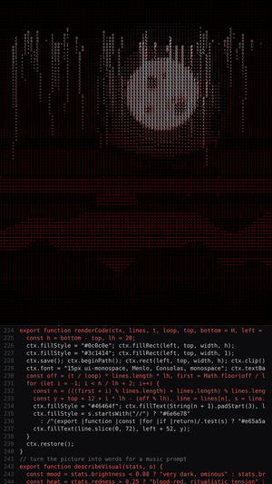
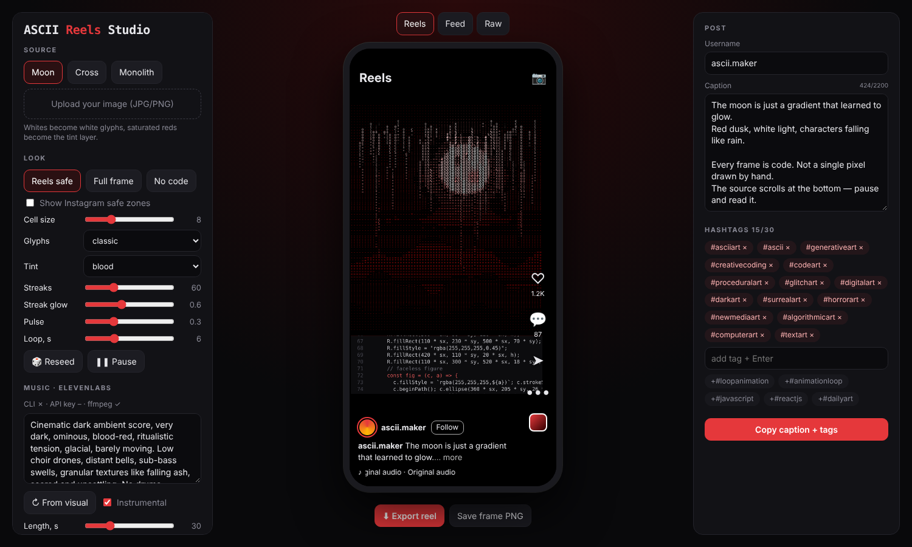
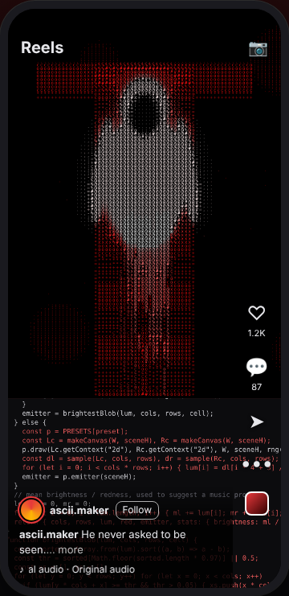
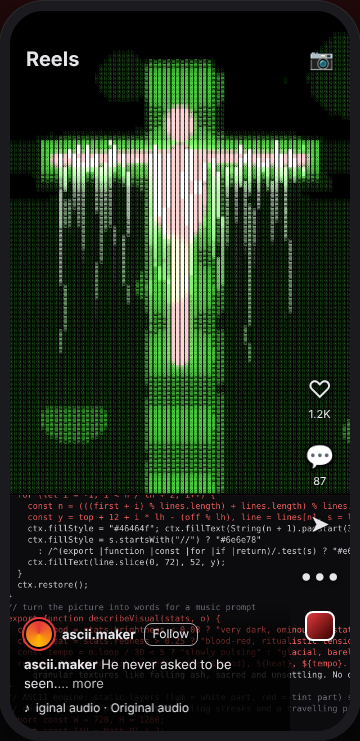
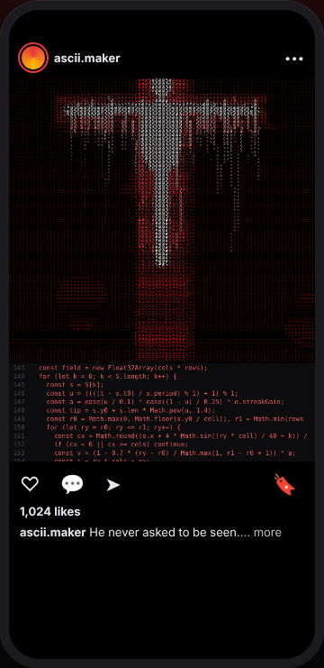
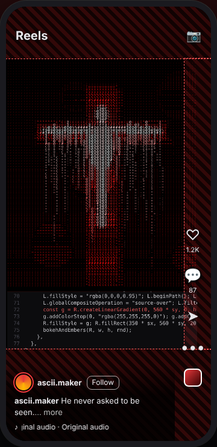

<div align="center">



# ASCII Reels Studio

**Turn any picture into a looping ASCII animation, preview it as an Instagram Reel,<br/>write the caption, pick hashtags, and score it with AI music from ElevenLabs.**

`React` · `Vite` · `Canvas 2D` · `Node/Express` · `ElevenLabs CLI` · `ffmpeg`

</div>

---

## ✨ What it does

| | |
|---|---|
| 🖼 **Scenes** | Built-in procedural scenes (*Cross*, *Monolith*) or **your own image** |
| 🔣 **ASCII engine** | Glyph ramps (`classic`, `blocks`, `dense`, `binary`, `dots`), cell size, colour tints |
| 🌧 **Animation** | Falling glowing streaks, a travelling pulse, flicker; all loop seamlessly |
| 🧾 **Code panel** | The engine's own source code scrolls under the scene, like in the creative-coding reels |
| 🛡 **Reels-safe layout** | Scene and code are placed so the Instagram UI never covers them; safe-zone overlay in the preview |
| 📱 **Instagram preview** | **Reels**, **Feed 4:5** and **Raw** views with a realistic overlay: avatar, caption with "… more", music ticker, side actions |
| #️⃣ **Caption & hashtags** | Caption editor with a 2200-character counter, hashtag chips with a 30-tag limit and suggestions, one-click copy |
| 🎵 **AI music** | Writes a music prompt **from the visual** (brightness, redness, tempo) and generates a track with the **ElevenLabs CLI** (REST API fallback) |
| ⬇ **Export** | Records the canvas and the music into a video; the local server converts it to an Instagram-ready **MP4** with ffmpeg |

## 📸 Screenshots

<p align="center">
  
</p>

<p align="center">
  
  &nbsp;
  
  &nbsp;
  
</p>
<p align="center"><sub>Reels · <i>Monolith</i> &nbsp;|&nbsp; Reels · <code>blocks</code> + <code>toxic</code> &nbsp;|&nbsp; Feed 4:5</sub></p>

## 🛡 Reels safe zones

Instagram draws its UI on top of a Reel: the status bar and back button cover the **top ~12%**, the caption and music line cover the **bottom ~21%**, and the action buttons cover the **right ~13%**. Tall phones also crop a little off both sides.
The default **Reels safe** layout keeps the scene and the code inside the visible box, and the bands are left black.

<p align="center"></p>

| Layout | Scene | Code panel | Use for |
|---|---|---|---|
| **Reels safe** *(default)* | 560×669 at (60, 160) | 560×170 at (60, 840) | Reels |
| **Full frame** | 720×860 | 720×420 underneath | TikTok/Shorts with an overlay you control, plain video |
| **No code** | 720×1280 | — | Background loops |

In the Python renderers, `SAFE = True` at the top of the script does the same.

## 🚀 Quick start

```bash
git clone https://github.com/shtanko-michael/ascii-maker
cd ascii-maker
npm install
cp .env.example .env      # Windows: copy .env.example .env
npm run dev               # web → http://localhost:5173, api → :8787
```

Production build, served by the API server:

```bash
npm run build && npm start   # → http://localhost:8787
```

### 🎵 Music with ElevenLabs

```bash
npm install -g @elevenlabs/cli    # or: brew install elevenlabs/tap/elevenlabs · scoop install elevenlabs
elevenlabs auth login
elevenlabs music --help           # check the exact subcommand and flags of your version
```

The server runs the command from `MUSIC_CMD` in `.env`. It is a JSON array and no shell is involved:

```env
MUSIC_CMD=["elevenlabs","music","compose","--prompt","{prompt}","--music-length-ms","{ms}","--output","{out}"]
```

Placeholders: `{prompt}`, `{ms}`, `{seconds}`, `{out}`. If your CLI version uses different flags, change only this line.
If the CLI call fails and `ELEVENLABS_API_KEY` is set, the server calls `POST /v1/music` directly.
The Music API is available on paid ElevenLabs plans only.

### 🎬 MP4 export

Install [ffmpeg](https://ffmpeg.org) (`winget install ffmpeg` · `brew install ffmpeg`).
Without it you get a `.webm`, and Instagram may not accept that format.

## 🧭 Workflow

```
 ┌─ Source ──────┐   ┌─ Look ───────────┐   ┌─ Music ─────────────┐   ┌─ Post ──────────┐
 │ preset/image  │ → │ glyphs · tint ·  │ → │ prompt from visual  │ → │ caption · tags  │ → ⬇ reel.mp4
 └───────────────┘   │ streaks · pulse  │   │ → ElevenLabs → mp3  │   │ IG preview      │
                     └──────────────────┘   └─────────────────────┘   └─────────────────┘
```

**Tips for your own images**
- White and grey areas become white glyphs; saturated red becomes the tint layer; other colours fade to black. High-contrast black, white and red images work best.
- Streaks start from the bottom edge of the brightest area of the image.
- Use a vertical image: it is cover-cropped to 720×860, or to 720×1280 with the code panel off.

## 🧠 How the engine works

```js
// 1. static layers sampled on the character grid
lum[i] = min(r, g, b)            // white part
red[i] = r - max(g, b)           // tint part

// 2. per frame
u    = ((t - t0) / period) % 1   // period divides the loop → seamless
tip  = y0 + len * u ** 1.4       // accelerating fall
a    = ease(u / .1) * ease((1 - u) / .25)
pulse(y) = sin(2π (y/120 - 2t/loop))

// 3. colour → glyph
v  = max(r, g, b)
ch = RAMP[round(v * (RAMP.length - 1))]
fillText(ch, x * cell, y * cell)   // coloured by the cell's RGB
```

## 🐍 Python version

`python/` contains the original offline renderers that write PNG frames:

```bash
pip install numpy opencv-python pillow
python python/crucifix.py [image.jpg]
ffmpeg -r 30 -i fr/%04d.png -pix_fmt yuv420p out.mp4
```

## 📁 Structure

```
├─ src/
│  ├─ engine.js     # ASCII engine: scenes, layers, streaks, frame & code-panel render
│  ├─ App.jsx       # editor, Instagram preview, caption/hashtags, music, export
│  └─ styles.css
├─ server/server.js # /api/music (ElevenLabs), /api/convert (ffmpeg), /api/health
├─ python/          # offline Python renderers
└─ docs/            # README media
```

## ⚖️ Note

Use your own images or content you have the rights to. Generated music follows the
[ElevenLabs terms](https://elevenlabs.io/terms-of-use).
